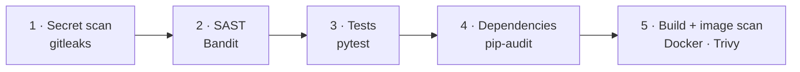

# DevSecOps pipeline with fail-fast security gates

[](https://github.com/tobolovskaya/devsecops-pipeline-lab/actions/workflows/devsecops.yml)

> 🇳🇴 **Kort på norsk:** En CI/CD-pipeline i GitHub Actions for et lite Flask-API, med sikkerhetsporter i rekkefølge: hemmelighetsskanning, SAST, tester, avhengighetsskanning og skanning av container-bildet. Første port som feiler stopper hele kjøringen, så usikker kode aldri blir bygget.

A small Flask API with a CI/CD pipeline where every stage is a security gate. The stages run in order and each one needs the previous one, so the **first failing gate stops the run** and insecure code is never built.

**Skills shown:** GitHub Actions · secret scanning (gitleaks) · SAST (Bandit) · SCA (pip-audit) · container scanning (Trivy) · supply-chain hygiene (pinned actions, verified downloads, Dependabot) · secure Python and Docker

## Pipeline



| Gate | Tool | Fails when |
|---|---|---|
| 1 · Secret scan | gitleaks 8.30.1 | a secret is found anywhere in the **git history**, not only in the last commit |
| 2 · SAST | Bandit 1.9.4 | a medium or high severity issue is found in the code |
| 3 · Tests | pytest | a test fails |
| 4 · Dependencies | pip-audit 2.10.1 | a pinned dependency has a known vulnerability |
| 5 · Image scan | Trivy 0.76.2 | the image has a critical vulnerability that already has a fix |

## Security fixes in the app

| Problem | Fix |
|---|---|
| `/execute` evaluates user input; with `eval()` that is remote code execution (Bandit B307) | `ast.literal_eval()` accepts only literals such as numbers and strings, and a test proves code is rejected |
| The result was put into HTML unescaped: reflected XSS | output is escaped with `markupsafe.escape`, covered by a test |
| `app.run(host="0.0.0.0")` in the code (Bandit B104) | removed; the container runs **gunicorn** as a non-root user |
| Unpinned dependencies, so pip-audit could not check exact versions | versions pinned, updated weekly by Dependabot |

## Supply chain

- GitHub Actions are pinned to **commit SHAs**, not tags. A moved tag cannot change what CI runs.
- The gitleaks binary is downloaded with a **SHA-256 checksum check**.
- Trivy scans the image from a **tar file**, so the scanner gets no access to the Docker socket.
- `permissions: contents: read`: the workflow token cannot write to the repository.

## Fail fast in practice

Open a pull request that adds insecure code, for example:

```python
import subprocess

@app.route("/ping")
def ping():
    host = request.args.get("host", "")
    subprocess.run(f"ping -c 1 {host}", shell=True)  # command injection
    return "ok"
```

Bandit reports `B602 subprocess call with shell=True` with high severity, gate 2 fails, and tests, dependency scan and build never start.

## One accepted finding

gitleaks flags a shortened example key (`sk-1234567890...`) in an old version of this README, where it illustrated what a secret scanner catches. It is not a real key, so its fingerprint is listed in [`.gitleaksignore`](.gitleaksignore) with the reason, instead of rewriting history.

## How to run locally

```bash
python -m venv .venv && source .venv/bin/activate
pip install -r requirements-dev.txt
pytest -q
bandit -r . -x ./tests,./.venv -ll
pip-audit -r requirements.txt --strict
docker build -t devsecops-demo . && docker run --rm -p 5000:5000 devsecops-demo
```

Then open <http://localhost:5000/execute?code=123>.

## Hva jeg lærte / What I learned

- **A pipeline that never ran proves nothing.** The first version was a GitLab CI file in a GitHub repository, so it never started. Moving it to GitHub Actions made every gate real.
- **Order matters.** Cheap checks (secrets, SAST) run first; the slow build and image scan run only when everything before them is clean.
- **Scan the history, not the last commit.** A secret deleted in a later commit is still in git.
- **Fixing one finding can open another.** `ast.literal_eval()` stopped code execution, but the output was still unescaped HTML: a reflected XSS that Bandit does not report.
- **Pin and verify the tools themselves**, not only the app's dependencies.

---

Originally built as coursework during my MSc in Computer Science (Woolf / GoIT Neoversity) with GitLab CI, then moved to GitHub Actions and hardened.

**Yevheniia Tobolovska** · IT operations and security · [Portfolio](https://my-portfolio-yevheniia-tobolovskas-projects.vercel.app/) · [LinkedIn](https://www.linkedin.com/in/yevheniia-tobolovska)

License: [MIT](LICENSE)
